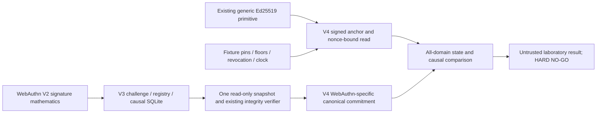

# AION V4 — signed WebAuthn anchor laboratory dossier

FIRST INSTALL = HARD NO-GO. Base #1219 at
3b10f809ae7f3cf1915051ac6f77ced155bc9c9f. No productive witness or auth wiring.

## Existing contracts and compatibility map

| Existing file / symbol | Reuse / limitation |
|---|---|
| V3 `ledger_storage.verify_locked`, `_rows`, `LedgerStorage.connect` | Exact schema, bounded rows, state/event/receipt invariants; native RO connection |
| V3 `ReferenceWebAuthnLedger` | Unchanged durable admission, atomic counter/consume, generations/revocation and postcommit UNKNOWN_OUTCOME |
| V2 `webauthn_reference.verify_assertion_reference` | Unchanged ES256 verification and fixture challenge scope/counter rules |
| `atlasquant_aion_runtime_source_boundary_ref_v1.canonical_bytes`, `_verify_sig` | Reused generic canonical encoding and cryptography Ed25519 verification, NEW explicit domains and closed payload schemas |
| `atlasquant_aion_checkpoint_dual_challenge_reference_v1.review_challenge_bound_dual_head` | Architecture reference for challenge/dual-source verification; its Git content_sha/resource contract is not cast to WebAuthn state |
| `atlasquant_aion_v2_external_witness_rollback_reference` | Old hold snapshot/collector receipt schema is incompatible; no digest is reinterpreted as a WebAuthn ledger commitment |
| `atlasquant_aion_v2_authenticated_witness_read_cas_reference` | Nonce/pin/CAS design reference, not reused financial head/query payload |
| `ReferenceIsolatedSqliteWitnessCAS` / one-shot journal | Existing local persistence/UNKNOWN_OUTCOME regressions retained; no new competing witness CAS/database service |

V4 adds an explicit typed adapter for existing generic Ed25519 verification and
V3 read-only integrity. It does not modify the frozen Core V1, old verification
helpers, auth, Worker, requirements or original evidence manifest. Witness
responses persist only as public JSON fixtures written by TEST code. The
product adapter reads them and has no writer, signer, provisioner or dispatcher.

## Cryptographic commitment

`commitments.capture_ledger_reference` reads head, registry, challenges,
attempts, receipts and ancestry from ONE SQLite read transaction. A concurrent
commit test demonstrates that head and state remain in the same old snapshot,
rather than mixing old sequence with new counter/state. Causal readback, if
requested, occurs inside that transaction and requires a CONSUMPTION receipt,
exact request digest and matching consumed attempt. No second writing read or
automatic completion is possible.

Closed commitment fields: schema; ledger_schema; owner/tenant/workspace;
ledger_id; epoch; sequence; local_head_sha256; state_digest;
credential_state_digest; generation_revocation_digest; challenge_state_digest;
causal_operations_digest; previous_commitment_digest; policy_id/version;
witness_id. Scope aliases and declared ledger/epoch/policy identify this lab
context; they do NOT enroll a physical file/device or actual institution.
The old V3 config has no institutionally enrolled ledger UUID/epoch.

Canonical ASCII JSON, sorted keys, compact separators, nonfinite values denied.
Explicit separate domains:

- AION_WEBAUTHN_LEDGER_COMMITMENT_V4
- AION_WEBAUTHN_LEDGER_STATE_V4
- AION_WEBAUTHN_CREDENTIAL_STATE_V4
- AION_WEBAUTHN_GENERATIONS_REVOCATIONS_V4
- AION_WEBAUTHN_CHALLENGE_STATE_V4
- AION_WEBAUTHN_CAUSAL_OPERATIONS_V4
- AION_WEBAUTHN_SIGNED_ANCHOR_V4
- AION_WEBAUTHN_AUTHENTICATED_HEAD_READ_V4
- AION_WEBAUTHN_FIXTURE_PIN_V4 / AION_WEBAUTHN_WITNESS_RECEIPT_V4

Each domain has a zero-byte terminator in code. State digest covers actual
WebAuthn rows; commitment digest covers the typed contextual commitment;
signature covers its envelope/profile/key/version; receipt digest covers the
signed envelope AND signature bytes. These are different objects. No old hold
count/amount or financial snapshot substitutes for WebAuthn state.

Only the established Ed25519 primitive verifies signatures. Signing and private
key generation appear in tests only. No cryptography is invented. Public key
pins, revocation lists and floors are explicit fixture inputs with separate
expected pin digest. Changing the pin without that expected digest blocks.
Changing ALL caller-owned expectations can still pass fixture mathematics;
every real trust/authority flag remains false. This limitation is tested.

## Monotonic floor, freshness and recovery contracts

An anchor must match exact ledger, scope, witness, policy and epoch. Same
sequence requires identical commitment digest; advancing sequence requires
the exact previous commitment digest. Unproven epoch transitions are denied.
Recovery also checks that the floor's local head exists at its sequence in the
captured V3 event ancestry. Claimed parent links alone are insufficient.

Read query has exact scope/ledger/witness, policy, expected key/generation,
root provenance digest, minimum epoch, nonzero 256-bit nonce, issue/expiry and
FIXTURE_CLOCK provenance. Signed response must bind ALL those response fields,
contain the exact commitment and pass signature, floor and TTL checks. TTL is
at most 60 fixture seconds; expired pin/query, unknown revocation state, changed
nonce, consumed nonce, stale head and incomplete payload block. Missing witness
returns UNKNOWN_OUTCOME with no local fallback.

Replay history is explicitly supplied, bounded and checked, not durably consumed
by readback. durable_nonce_consumption_verified=false. Its externally protected
issuance/consumption and a trusted clock remain future dependencies. A repeated
response for the SAME pending query with a falsely empty fixture replay history
can remain mathematically valid; no independent freshness is inferred.

`recovery_bridge.compare_anchors_reference` verifies all three declared fixture
members BEFORE opening the local DB, rejects conflicting states or shared
operator/admin/key/witness labels, then compares ALL local state digests and
ancestry. No majority vote, reduced quorum or unavailable-domain fallback.
Different labels are NOT evidence of different institutions; the positive
state is explicitly REFERENCE_*_MATH_UNTRUSTED. The causal wrapper additionally
requires the exact historical consumption receipt; metadata equality is not
proof of an uncertain operation's effect.

The adapter cannot consume, clear, release, rotate, revoke, restore or retry.
V3 direct experimental consumption is unchanged: it does not gain production
antirollback merely because a new read-only comparison exists. Any future
production integration needs independently established trust and a separate
authorized gate; bypassing comparison remains out of production scope.

## Threat/scenario matrix — successes AND known negative

| Scenario | Executed laboratory result |
|---|---|
| A: ledger restored, signed newer heads retained outside that restored file | Pure state comparison BLOCKED; missing consumption remains RECONCILIATION_REQUIRED |
| B: ledger AND witness files restored | Matching old signed state remains self-consistent; MATH_UNTRUSTED may pass; external/rollback authority stays false |
| C: two histories, same sequence, incompatible hashes | BLOCKED, including two-versus-one disagreement; no majority |
| D: correctly signed old anchor behind newer floor | BLOCKED |
| E: absent witness | UNKNOWN_OUTCOME, no local fallback |
| F: valid signature for wrong tenant | BLOCKED BEFORE local DB read |
| G: revocation erased by old backup | Newer retained generation/revocation commitment detects regression |
| H: rotation erased by old backup | Newer retained generation digest/head detects regression |
| I: counter + ISSUED challenge jointly restored | Retained newer head detects mismatch; local rows alone look consistent |
| J: three files/processes/signatures, same admin | BLOCKED when declared same; forged distinct labels still never prove independent custody |
| Commit persisted then ACK lost | UNKNOWN_OUTCOME preserved; anchored causal read finds effect without resend |
| Before final commit / pending admission | No consumption receipt; RECONCILIATION_REQUIRED, no automatic completion |
| Incorrect state signed correctly | Local full-state comparison BLOCKED |
| Fake parent/floor ancestry | BLOCKED even if signatures/sequence are valid |
| Read-close error, including absent receipt branch | UNKNOWN_OUTCOME; no exception/secret echo |
| Four processes consume one challenge | One durable consumption; anchored historical read succeeds untrusted |
| Process os._exit after consumption commit | Another local context reads committed effect; no retry |

These are real disposable SQLite copies, WAL commits, file persistence,
subprocesses and signature verification. They are NOT physical power-loss,
TPM/FIDO, independently administered infrastructure or browser conformance tests.

New boundary hardening found by adversarial tests: the first fixture JSON reader
accepted a top-level nested array (valid JSON) before downstream schema rejection.
It now validates the exact read envelope and commitment at ingress. Duplicate
fields, nonfinite/malformed/oversize JSON are rejected. LOW reference boundary
gap; no productive authorization existed. No old tests were removed or weakened.

Final static/adversarial review reproduced another LOW context ambiguity: an
unexpected local leading witness ID could be normalized away during the
all-domain state comparison. The bridge now validates the original config and
requires its leading witness to equal the first expected pinned member BEFORE
any local read. Each member still has its own signed witness ID/parent chain;
the negative test ensures the local context cannot silently be rebound. The
previous positive result was untrusted laboratory mathematics, not authority.

## Trust root, enrollment, custody and exceptional recovery blueprint

New closed JSON schema/example accepts ONLY synthetic root/public pin and UNKNOWN
authorization, institution, custody, independent receipt, revocation and operator
separation evidence. Self-declared VERIFIED claims or permission fields reject.
No real enrollment happens. Example hash/public key does not establish provenance.

A future authorized implementation would need an already trusted root obtained
outside the requester/ledger/browser, institutional evidence establishing who
controls it, root-signed witness key scope/generation/validity and independent
verification of that enrollment. Different key material, operator identity and
administrative domain must be evidenced separately. No requester-controlled
pin/floor replacement may become the new expected reference by itself.

Revocation must cover operators AND keys through authenticated current records.
Root rotation/custody loss require separate explicit owner authorization,
independent quorum POLICY evidence (not raw signature count), revocation of old
material and documented recovery, without auto-enabling requests. New sequences
need independent receipt/retention outside the rollback domain, replay-resistant
reads, monotonic history/fork detection and protected backups/immutable evidence.
Real cross-domain custody, hosting, source enrollment and root bootstrap remain
UNKNOWN. Nothing in these fixtures supplies them.

## Architecture / FinOps / installation decisions

Solved in lab: one restored local ledger is detected against a retained correct
signed fixture head/floor. NOT solved: simultaneous rollback of every controlled
file/pin/floor/replay history, dishonest self-administered witnesses, key custody
fraud, trusted time, or privileged recomputation. All remain deployment blockers.

An actual online design would require a monotonic coordinator, separately
administered witness/current head, independent retained append evidence, protected
root/key/revocation custody and authenticated fresh reads. Same account/provider
or three processes alone cannot establish independent authority.

No new purchased service is needed for THIS offline mission. A later experiment
could use existing separately controlled devices and a genuinely separate human
custodian for manual signed receipts; feasibility, custody, hardware, uptime,
recovery and costs are UNKNOWN, not a verified production alternative.

Cloudflare's current official documentation describes a SQLite Durable Objects
Free tier with usage limits. That is a possible future quotation/model input,
not evidence of independent custody, available capacity or an authorized service.
The Free tier fails operations beyond its limits. No provider was provisioned.
[Official pricing](https://developers.cloudflare.com/durable-objects/platform/pricing/),
[official limits](https://developers.cloudflare.com/durable-objects/platform/limits/)
(read 2026-10-11).

Impact on reference R$200/month cap: no spend was performed; total future design
fit is UNKNOWN. Required quotation dependencies: hosting by domain, independent
retention/backup, root custody/device costs, monitoring, secure access, model/API
use if ever separately approved, domains, taxes, BRL exchange and headroom. Free
quotas or published USD rates are not a verified full BRL contractual quote.
full_quote_brl_verified=false; owner_approved_spend=false. Original cap unchanged.

Before any Windows installation: physical owner/device enrollment, actual source
root/FileID/path/ACL identity, protected keys/TPM/passkey custody where applicable,
secure login/recovery, independent counter/rollback restoration negatives,
tenant separation and data minimization must produce authorized private evidence.
No physical Windows, credential, security-setting or customer-data checks were
performed. Installation, key/root enrollment, external provisioning/spending,
merge, deploy and Worker activation need distinct explicit approvals after
evidence review. They are not inferred from each other or from CI.

For companies/real data: missing institution/root provenance, external retention,
trusted current revocation, immutable custody, confidentiality/access/retention
review, operational reliability and full budget block use. No LGPD compliance
or service readiness is certified by this code.

## Validation and next safe package

Dedicated Windows/Linux CI runs V4 signature/commitment, freshness/provenance,
rollback/fork/causal/process suites and unchanged V3/V2/V1 groups. Pinned base
requirements and hash-pinned fido2 CI-only dependency stay unchanged. Every group
reports actual tests/subtests/errors/failures/skips/expected failures separately;
module overlap fails the runner. Original full Linux Quality, compileall,
exact-base diff check and 20-gate check remain mandatory on final HEAD.
Live final-head evidence is recorded in the Draft PR body, not inferred from
base #1219 green checks. Local logs/patch are preserved beside the isolated
snapshot; none contains actual private credentials.

Next safe package: an offline admission-boundary model that consumes verified
anchor observations with an independently supplied monotonic receipt policy,
explicit epoch/root transitions and revocation/replay provenance, reusing the
existing CAS/journal contracts WITHOUT mapping financial digests to WebAuthn.
No production witness, enrollment or automated consumption should be introduced
until the external trust/physical evidence and separate authorizations exist.

FIRST INSTALL = HARD NO-GO. The separate inventory lists all 20 unchanged gates.
