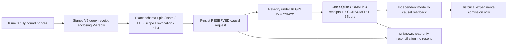

# AION V5 — durable local receipt admission laboratory

FIRST INSTALL = HARD NO-GO. Twenty original external gates remain BLOCKED.
Base #1220: `8a143ee40b9f6893845817d61b564ccc47611502`.
This child does not modify V1–V4, Core V1, productive authentication, Worker,
requirements or the original evidence manifest. One isolated source snapshot
and one remote child branch are used; existing local Git work is preserved.

## Responsibility and assurance map

| Concept | Existing component reused | V5 meaning / limit |
|---|---|---|
| Mathematical signature | Generic canonical/Ed25519 primitive; V4 signed_anchors | Valid signature under an expected fixture public key; no institutional identity |
| Local ledger integrity | V3 LedgerStorage; V4 commitments | Exact schema, constraints, bounded rows, causal chain and coherent native read snapshot |
| Durable receipt | V5 admission/storage | Historical local SQLite transaction independently read back; no external retention |
| Freshness | V4 query/TTL | Caller-supplied FIXTURE_CLOCK; no trusted real clock |
| Key provenance | V4 pin; V5 immutable bootstrap digest | Caller-owned synthetic pin/root, not enrollment |
| Independent custody | V4 enrollment blueprint / V5 UNKNOWN proofs | Not demonstrated by files, labels, processes or three keys |
| Human consent | V5 event-bound SIMULATED_ONLY approval | No real ceremony or HUMAN_OWNER authentication |
| Execution permission | Protected V1/V4 output contracts | All productive flags remain false, including installation, Worker and spending |

V3 challenge consumption and the older financial CAS/journal remain unchanged.
Their purpose-specific closed schemas are not cast into WebAuthn schemas. V5
reuses V3 per-call native connections/serialization, V4 signatures, pins,
commitments, all-domain policy and causal readback. New purpose-specific tables
are necessary to commit three receipts/nonces/floors in one local transaction.
No duplicate production identity service, signer, network client or executor
is introduced. The old references remain experimental direct consumers.

## Flow and transaction boundaries

Reservation and admission are two distinct durable transactions. Receipt
admission, nonce consumption and floor advance are atomic within the second.
No atomicity is claimed with the V3 ledger, witnesses or external institutions.
V4 reads V3 in a coherent single native read transaction. V3 can change after
that read; V5 therefore admits a historical observation, not a latest-head claim.
It does not execute or re-enable a consumed WebAuthn operation.

All three witnesses are mandatory. Two valid replies cannot override a missing,
invalid or divergent third reply. There is no majority or local fallback.
V5 additionally signs the digest of the COMPLETE issued binding, covering the
V4 query, root/generation, expected pin, minimum sequence, challenge, operation,
attempt, expected commitment, previous receipt and revocation head. Merely
presenting a signed V4 response is insufficient for V5 admission.

Canonical V5 JSON ingress rejects duplicates, nonfinite values, unknown schema,
noncanonical encoding and oversized input. Receipt hashing includes signatures;
the generic signing primitive intentionally excludes only its outer signature.
Private keys exist only in disposable test memory, never in published fixtures.

## State machines

| Object | Allowed evolution | Denial / recovery |
|---|---|---|
| Nonce | ISSUED → RESERVED → CONSUMED; ISSUED/RESERVED → QUARANTINED | No release/reissue. Expired cannot admit. RESERVED uncertainty cannot resume automatically |
| Receipt | Received externally → absent locally → admitted in atomic local commit | Received is not persisted. Duplicate ID or changed causal request blocked |
| Floor | Nondecreasing commitment sequence, same-sequence exact commitment only, linked parent and receipt | Wrong parent, scope, root, fork or lower head blocked |
| Fixture root | FIXTURE_ACTIVE → FIXTURE_REVOKED | No reactivation. Rotation is a candidate, never an active new pin |
| Epoch | Established epoch N → signed candidate N+1 | No automatic epoch activation; jumps/regressions/unestablished epochs blocked |
| Revocation | Append-only signed local event and head | Known root/key/operator/generation denies future admission; erased event detected against retained newer reference |
| Recovery | UNKNOWN_OUTCOME → read-only historical evidence or RECONCILIATION_REQUIRED/BLOCKED | No retry, dispatch, claim release or promotion to productive authority |

The nonce's complete scope includes owner, tenant, workspace, ledger, witness,
pin/key generation and public key via the immutable pin digest, fixture root
generation, minimum epoch/sequence, query digest and commitment expectation.
Floors explicitly carry root/generation; commitments carry witness/full scope/
epoch/sequence/head/state; floors retain receipt ID/hash/previous receipt hash.

The bootstrap config is immutable and checked against a separate expected digest.
Caller repinning an existing database is rejected. Choosing a wholly new DB and
new caller-owned digest creates another untrusted fixture, never a trusted root.

Root rotation requires fixture old/new mathematical signatures and an event-bound
simulated approval. Operator rotation, key rotation and custody transfer remain
distinct proposal kinds. Witness replacement/admin transfer carry a closed
proposed identity. Required institutional custody, independent owner consent,
trusted time and independent revocation proofs are UNKNOWN. Old-root loss,
custody compromise and generation revocation conservatively deny locally;
exceptional recovery never re-enables the root. Rotation cannot override a
concurrent revocation. CAS rejects a second transition from the same prior head.

## Local persistence and bounds

Three closed SQLite tables: immutable bootstrap, current state and append journal.
Every operation owns its thread-affine connection (default SQLite thread checks).
WAL/FULL are reused. No connection cache or check_same_thread=False exists.
BEGIN IMMEDIATE and compare-and-swap on sequence/head serialize processes.
Exact stored DDL, primary/unique/check constraints and no extra trigger/view are
verified. Native quick_check and journal/state reconstruction precede mutations.
Nonce regression/rebinding/erasure, receipt erasure, root reactivation, revocation
erasure and floor divergence are rejected even when an internal last hash is
recomputed. This is consistency checking, not cryptographic custody of the DB.

Limits: 128 journal events, 96 nonce/receipt rows in the state, three members,
262144 ASCII characters per state snapshot, bounded identifiers/digests and 8192
bytes for receipt JSON ingress. Byte capacity can be exhausted before row count;
exhaustion blocks without pruning or automatic rollover. Snapshots intentionally
duplicate bounded state for reconstruction; this laboratory is not a scalable
production persistence design. SQL length checks run before row materialization.

Readback uses a separate native mode=ro/query_only connection and never creates
a missing DB. A retained {config digest, journal sequence, journal head} must be
supplied. Readback checks ancestry and exact operation/request digest. Missing
receipt is reconciliation-required, not permission to retry. Error/timeout/
corruption/close failure cannot produce a confirmed positive. Fixed error codes
avoid exposing exception contents or credentials.

## Findings reproduced and corrected

| Risk | Evidence / correction | Residual |
|---|---|---|
| MEDIUM within the offline admission model | V4 accepts the same nonce twice with caller-provided empty consumed_nonces. New regression reproduces both calls, then demonstrates durable V5 replay denial | Unchanged V4 remains mathematical verifier, not durable admission; production authority was never granted |
| LOW new implementation finding | Initial V5 unknown receipt field returned RECONCILIATION_REQUIRED instead of BLOCKED. Strict regression failed; ContractError classification corrected without weakening assertions | No write occurred and authority stayed false in the failed run |
| HIGH deployment blocker | Restore older admission DB while retaining later journal floor → BLOCKED. Restore DB AND caller-owned floor → locally consistent and can admit the old receipt again | Privileged joint restoration remains undetectable; no independent monotonicity claimed |
| HIGH deployment blocker | Erase revocation by restoring old DB plus all references | Same authority can restore keys/config/ledger/history; independent revocation/custody absent |
| HIGH deployment blocker | Three distinct caller-controlled fixture domains and valid signatures | Institutional identity/custody, real time and root provenance remain unproved |

No productive exploit or external institution compromise was demonstrated.
The HIGH items block deployment/installation rather than falsely claiming that
the fixtures themselves authenticate an institution.

## Threat and adversarial evidence matrix

| Scenario | Test evidence / expected result |
|---|---|
| Wrong query/scope/root/key/epoch/operation/challenge/attempt/state | New receipt tests; BLOCKED before consume; wrong tenant before V3 access |
| Signature/schema/algorithm/duplicate JSON/encoding tamper | V5 ingress/admission and unchanged V4/V2; BLOCKED |
| Receipt received but unadmitted | Zero receipts until local transaction; presence never success |
| Replay, restart, four competing native processes | One admitted bundle / three receipts; no second confirmation |
| Commit ACK loss, floor/nonce ACK loss, close failure | UNKNOWN; separate causal read confirms historical durable commit only |
| Reservation ACK loss / consumption precommit failure | RESERVED and no receipts/floor advance; no automatic continuation |
| Abrupt process os._exit immediately after SQLite commit | Parent readback finds exactly one bundle; retry denied (not physical power loss) |
| Lock, missing/corrupt store, constraints removed, unexpected trigger | Fail closed; no missing DB creation |
| Competing epochs / rotation versus revocation | Two real processes; only one CAS from the shared prior head; no root activation |
| Revocation between reservation/admission | Second transaction denied; pending nonces remain RESERVED |
| Lower/same-fork/wrong-parent floor and divergent witnesses | Correctly signed negative replies still blocked; no majority |
| New witness head / old V3 ledger, counter/challenge/generation rollback | Unchanged V4 real SQLite restore/process regressions |
| Revocation erased, old floor/new receipt, joint restoration | New actual SQLite backup/restore; later retained ref detects; joint restore known negative |
| Reconciliation interrupted or close ACK lost | UNKNOWN; no retry |
| Fake institution labels, caller pin, synthetic clock, inferred consent | All external/physical/productive authority false even on successful local admission |

## Validation and immutable gates

Dedicated V5 Windows/Linux workflow includes four new nonoverlapping module
groups and every unchanged V4/V3/V2/V1 group. Network connections are forbidden
during the suites. Original full Linux Quality is run via the exact original
quality-step helper, with no omitted root modules. Pinned CI-only dependencies,
compileall and exact-base git diff --check are included. Local results are in
the V5 validation report; final candidate SHA/job links and actual final CI
results are recorded in the Draft PR body. Earlier/base CI is never counted as
candidate validation. Tests/subtests/global counts are separate; discovery and
global regressions overlap and are not added.

Original manifest digest:
`b95f4065edfa3d871e40f885d9133954ece871391896bbe3d0344e922ba48516`.
The companion inventory preserves all 20 BLOCKED requirements byte-for-byte
in the original manifest. Local CAS and crypto preparation do not satisfy
COORDINATOR_ATOMIC_CAS or any other external/physical production gate.

## Evidence unavailable and future governance

No real institutional custody or independently provisioned witness, physically
authenticated owner, Windows Hello/FIDO2/TPM enrollment, trusted clock,
independent current-head/rollback anchor, real installer signature, real browser
ceremony, physical Windows/device testing or physical power-loss test occurred.
No production data/checkpoint or credentials were used. Windows/Linux CI runners
are software evidence only. No Worker, paid model, financial/trading execution,
publication, deployment or installation exists in this package.

Future data-protection design must define controller/operator responsibilities,
tenant access boundaries, data minimization, key custody, retention/deletion,
residency, incident reporting and auditable access. Public test aliases are not
customer data. This is a requirements list, not an LGPD compliance certification.
Legal/contractual validation and authenticated external evidence remain pending.

## FinOps architecture comparison (no price claims)

| Future option | Required real evidence / cost dependency | Fit to R$200/month |
|---|---|---|
| Independent witness + immutable remote retention | Contract, independent operator/key/root enrollment, storage/write/read/egress, retention capacity, trusted head and time | UNKNOWN; full BRL quote required |
| Three separately controlled witnesses | Three independently verified administrative/failure domains plus recovery/revocation channels and all mandatory capacity | UNKNOWN; no assumption of free service |
| Local SQLite + separate retained read-only anchor | Physical owner/anchor custody and off-machine rollback-resistant latest reference | UNKNOWN; local file alone fails independent-custody gate |

No quote, FX rate, tax, minimum price or free-tier entitlement is invented. The
R$200/month reference cap is unchanged; nothing is contracted/provisioned/spent.
Technical software selection does not authorize financial commitments.

## Minimum prerequisites for a future controlled Windows experiment

Separate explicit HUMAN_OWNER approval naming the exact test-only scope/device/
tenant, test accounts and no-install/no-Worker limits; independently authenticated
owner/device evidence; reviewed source identity and installer/test harness
signature; enrolled expected test root/public keys with authenticated custody;
independent retained head and revocation channel; trusted time assumptions and
negative rollback/power-loss/recovery procedure; isolation/privacy/retention
review; confirmed zero-spend scope or explicit separately approved budget.
Approval for this offline V5 does not satisfy those prerequisites. Even a future
controlled physical experiment would not authorize production installation.

## Next mission

Highest-impact next preparation: an offline signed provenance/revocation-channel
adapter with a separately retained monotonic reference and explicit verification
of the minimum external evidence above. Keep root/epoch activation unavailable
until genuine independent proofs and owner authorization exist. Do not implement
a flag, simulated proof upgrade, majority fallback or automatic uncertain retry.
FIRST INSTALL remains HARD NO-GO.
